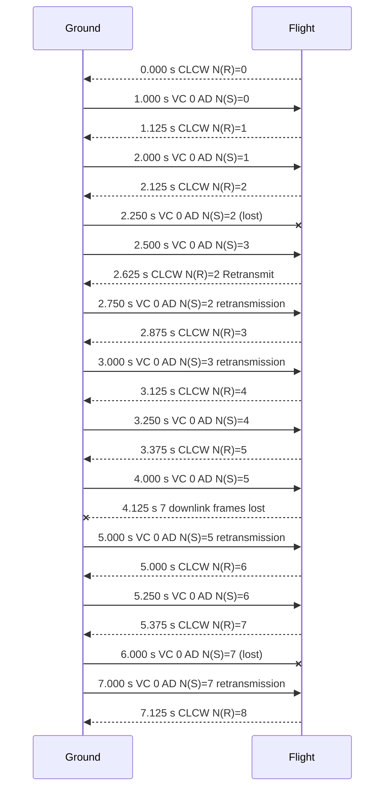

# Aldis

[](https://github.com/kscharpf/aldis/actions/workflows/ci.yml)

CCSDS (the Consultative Committee for Space Data Systems) publishes the standard protocols that spacecraft and ground stations use to exchange commands and telemetry. Aldis is a CCSDS protocol stack for spacecraft flight software and ground systems, written in Rust (`no_std`, no heap, panic-free) with a C ABI for C and C++ applications. It implements Space Packets, Encapsulation Packets, time codes, TM, TC, AOS, and USLP Transfer Frames, frame synchronization, COP-1, and the sans-I/O engines that link them: you hand the library bytes and time, and it hands back bytes and events.

Aldis has two aims. It is meant to be a usable CCSDS stack that comes with the correctness evidence expected of safety- and mission-critical software. It is also a showcase of how embedded high-assurance Rust can be built and verified, largely by coding agents under a reproducible merge gate.

> [!NOTE]
> **Pre-release, under active development.** It has not been qualified against any standard, its wire behaviour has not yet been exercised against an independent implementation, its API may change in any 0.x release, and the crates are not published to crates.io. Details: [status](#status) and [limits](#limits).

## How it fits together

Data moves down through three kinds of part, and back up the same way on the other end of the link:

```text
  your application: telemetry, commands, files
        |  data units in, data units out
        v
  PACKETS     Space Packet (SPP), Encapsulation Packet (EPP)     aldis-spp, aldis-epp
        |  carried in the data field of
        v
  FRAMES      TM, TC, AOS, USLP Transfer Frames                  aldis-tm, -tc, -aos, -uslp
        ^  built and taken apart by
        |
  ENGINES     aldis-link: packets to frames, channel multiplexing, reception,
              extraction, segmentation and reassembly
              aldis-cop1: on the TC link, FOP-1 (sender, ground) retransmits frames
              until FARM-1 (receiver, flight) reports them accepted in the CLCW
        |  frame bytes (aldis-sync: ASM, CADU, randomizer of 131.0 §9-10)
        v
  your radio, modem, or socket
```

The codecs are stateless functions from bytes to fields and back. The engines hold state, but do no I/O and keep no clock of their own, so every run is deterministic. The [architecture](docs/01-architecture.md) has the full layer diagram.

## Example

Encode a Space Packet and decode it again, through the `aldis` facade with the features `core` and `spp`. This code is compiled and run as a doctest of [`crates/aldis/README.md`](crates/aldis/README.md), and `cargo xtask consistency` checks that it is the same code.

```rust
use aldis::core::ids::{Apid, SeqCount};
use aldis::spp::{
    PRIMARY_HEADER_LEN, PacketFields, PacketType, SequenceFlags, SpacePacket, SppConfig, encode,
};

fn main() -> Result<(), aldis::core::Error> {
    let fields = PacketFields {
        packet_type: PacketType::Telemetry,
        apid: Apid::try_from(0x123)?,
        sequence_flags: SequenceFlags::Unsegmented,
        sequence_count: SeqCount::try_from(42)?,
    };
    let packet = SppConfig::DEFAULT.packet(fields, &[], b"hello")?;

    let mut buf = [0_u8; 64];
    let len = encode(&packet, &mut buf)?;
    assert_eq!(len, PRIMARY_HEADER_LEN + 5);

    let decoded = SpacePacket::decode(&buf[..len])?;
    assert_eq!(decoded.apid().get(), 0x123);
    assert_eq!(decoded.sequence_count().get(), 42);
    assert_eq!(decoded.data_field(), b"hello");
    Ok(())
}
```

The decoded packet borrows the buffer: nothing is allocated, and every error is a value, never a panic. Each crate has its own README with an example; the [crate list](#layout) links them.

### A COP-1 run over a lossy link

Run the reference application's lossy-link case with one command; it needs only `cargo`. The harness runs the case, prints one line per event decoded with the strict codecs, and compares the run with the golden trace [`refapp/golden/a3-uplink-loss.jsonl`](refapp/golden/a3-uplink-loss.jsonl):

```sh
cargo run --manifest-path refapp/Cargo.toml -p refapp-harness -- demo
```

The reference application sends commands over a link that loses frames. The ground node uses a COP-1 sequence-controlled service (Type-AD frames); the flight node reports in the CLCW of its telemetry frames. The notation, from CCSDS 232.0-B and 232.1-B (the [glossary](docs/glossary.md) has each term): Type-AD is the sequence-controlled kind of TC frame, which the ground node numbers and retransmits until it is acknowledged (232.0 §4.1.2.3, Table 4-1; 232.1 Annex A). N(S) is the frame sequence number the ground node gives each Type-AD frame (232.0 §4.1.2.8). The CLCW (Communications Link Control Word, 232.0 §4.2) is the status report that the flight node sends back in its telemetry frames, and N(R) is the sequence number in it that the flight node expects next (232.0 §4.2.1.11).

The uplink frame N(S)=2 is lost, the CLCW reports N(R)=2 with the Retransmit flag, and the ground node retransmits. A later run of lost downlink frames and a second lost uplink frame show the timer-driven retransmissions. The diagram and the text output are generated from the golden trace, decoded with the strict codecs, and `cargo xtask fix` keeps both current.

The same run, drawn as a sequence diagram:

<!-- BEGIN GENERATED: sequence-diagram (cargo xtask readme-diagram --write) -->

<!-- END GENERATED: sequence-diagram -->

<details>
<summary>The text output of the command</summary>

<!-- BEGIN GENERATED: demo-output (cargo xtask readme-diagram --write) -->
```text
a3-uplink-loss: COP-1 over a lossy link, decoded with the strict codecs
 0.000 s  down  VC 7 TM  CLCW N(R)=0
 1.000 s  up    VC 0 AD N(S)=0
 1.125 s  down  VC 7 TM  CLCW N(R)=1
 2.000 s  up    VC 0 AD N(S)=1
 2.125 s  down  VC 7 TM  CLCW N(R)=2
 2.250 s  up    VC 0 AD N(S)=2  LOST
 2.500 s  up    VC 0 AD N(S)=3
 2.625 s  down  VC 7 TM  CLCW N(R)=2 Retransmit
 2.750 s  up    VC 0 AD N(S)=2 retransmission
 2.875 s  down  VC 7 TM  CLCW N(R)=3
 3.000 s  up    VC 0 AD N(S)=3 retransmission
 3.125 s  down  VC 7 TM  CLCW N(R)=4
 3.250 s  up    VC 0 AD N(S)=4
 3.375 s  down  VC 7 TM  CLCW N(R)=5
 4.000 s  up    VC 0 AD N(S)=5
 4.125 s  down  7 frames LOST
 5.000 s  up    VC 0 AD N(S)=5 retransmission
 5.000 s  down  VC 7 TM  CLCW N(R)=6
 5.250 s  up    VC 0 AD N(S)=6
 5.375 s  down  VC 7 TM  CLCW N(R)=7
 6.000 s  up    VC 0 AD N(S)=7  LOST
 7.000 s  up    VC 0 AD N(S)=7 retransmission
 7.125 s  down  VC 7 TM  CLCW N(R)=8
verdict: the run matches refapp/golden/a3-uplink-loss.jsonl
```
<!-- END GENERATED: demo-output -->

</details>

## Using it

The crates are not on crates.io. From Rust, depend on the facade crate `aldis` from git, and enable only the features you use (none is on by default, and with none it builds for a `no_std` target). The features are `core`, `time`, `spp`, `epp`, `tm`, `tc`, `aos`, `uslp`, `spp-time`, `sync`, `link`, `cop1`, and `full`. The tag is a release of a [milestone](docs/08-roadmap.md#5-releases):

```toml
[dependencies]
aldis = { git = "https://github.com/kscharpf/aldis", tag = "v0.6.0-m5", default-features = false, features = ["core", "spp"] }
```

From C or C++, build the static library `libaldis_ffi.a` from a clone of the repository; Cargo writes it to `target/release/`. The header `include/aldis/aldis.h` is generated and committed, and `include/aldis/aldis.hpp` is the header-only C++ wrapper of the engine handles. Add `include/` to the include path and link the library:

```sh
cargo build -p aldis-ffi --release
```

The [aldis-ffi README](crates/aldis-ffi/README.md) has the conventions, the bare-metal build, and the build-time capacities.

## Where to start

1. [docs/README.md](docs/README.md): reading order and document map (contributors and coding agents: also read [AGENTS.md](AGENTS.md))
   - [docs/glossary.md](docs/glossary.md): what OCF, CLCW, FHP, and the other acronyms mean, and the project's own terms
2. [docs/01-architecture.md](docs/01-architecture.md): layers and crates
3. [docs/09-open-issues.md](docs/09-open-issues.md): decisions still needed

## Status

| Capability | State |
|---|---|
| Time codes, Space Packets, Encapsulation Packets | Released |
| TM, TC, AOS, and USLP Transfer Frames | Released |
| COP-1 (FOP-1 and FARM-1) and frame synchronization | Released |
| Link engines: packet and frame generators, multiplexing, reception, segmentation, CLTU packing | Released |
| C ABI and C++ header over all of the above | Released |
| Reference application: flight and ground nodes with packets, TM and TC frames, and COP-1 over a lossy link, golden traces | Complete |
| Reference application: AOS and USLP variants, C and C++ flight side, bare-metal target | Planned |
| Simplifying the crate architecture | In progress |
| Interoperability against an independent ground system | Planned |

Each released row has its tests, test vectors, and hazard analysis. The [roadmap](docs/08-roadmap.md) has the milestone detail, and its [coverage table](docs/08-roadmap.md#9-ccsds-document-coverage) lists the CCSDS documents and sections covered.

## Limits

- v1.0 is not released: it waits on the architecture simplification and the last reference-application milestone ([roadmap §5](docs/08-roadmap.md#5-releases)).
- Aldis has not been qualified against any standard and claims compliance with none. It is designed so that a later qualification (for example NASA NPR 7150.2 Class B/C, ECSS-E-ST-40C/Q-80C, or DO-178C) needs evidence collection rather than redesign ([assurance target](docs/06-verification.md)).
- Its wire behaviour has not yet been exercised against an independent implementation; the AINT milestone (interoperability) plans that: the reference application's flight node would exchange frames and COP-1 with an independent ground system such as YAMCS, run as a black box ([plan](docs/milestones/aint-interoperability.md)).
- Its API may change in any 0.x release (pre-1.0 versions promise no stability); the [changelog](CHANGELOG.md) lists the breaking changes.
- Outside contributions are not being accepted yet. The repository is public as a showcase, which also lets it use free verification tools that require a public repository ([open issues](docs/09-open-issues.md)).

## Evidence

Every claim of correctness is backed by a check that the merge gate runs or by a record a person signed, not by assertion. The README does not repeat them; the documents do.

- [Verification](docs/06-verification.md): the lints, link-time panic freedom, coverage, fuzzing, mutation testing, hand-derived test vectors from blind independent models, cross-checks, and the targets (including bare-metal QEMU runs).
- [Test vectors](docs/07-test-vectors.md) and [cross-checks](docs/verification/cross-checks.md): the shared conformance data, which is also run through other implementations of the standards: the `spacepackets` Rust crate, and NASA cFE's `MSG` module (v7.0.1, vendored unmodified), which agrees with `aldis-spp` on the Space Packet primary header, the sequence count, and cFE's CUC telemetry time.
- [Traceability](docs/06-verification.md): every requirement cites its Blue Book clause and every test names the requirements it covers; `cargo xtask trace` reports what is traced.
- [The merge gate](docs/06-verification.md#7-verification-runs-and-the-merge-gate): a reproducible run of every check in a digest-pinned image, with a published evidence record.
- [Assurance case](docs/verification/assurance-case.md) and [hazard analysis](docs/verification/hazards.md): the argument from claims to evidence, and the failure modes.
- [Design rules](docs/02-design-rules.md) and [hardware assumptions](docs/hardware-assumptions.md): what the code may and may not do, and what it assumes of the platform.

## How it is built

Aldis is built by coding agents under rules a person sets. Implementation agents work in their own worktrees, a fresh independent reviewer agent reviews each pull request before it merges, pull requests merge in trains that are verified as a whole, and the maintainer decides scope, API and ABI, dependencies, releases, and every merge.

- [AGENTS.md](AGENTS.md): the rules for coding agents.
- [Decision rights](docs/process/decision-rights.md): who decides what.
- [Independent review](docs/process/review.md) and the [coordinator](docs/process/coordinator.md): the review protocol and the merge trains.

## Layout

```
aldis/
├── Cargo.toml            workspace (edition 2024, shared lint set)
├── AGENTS.md             guide for contributors and coding agents
├── docs/                 the specification: start at docs/README.md
├── specs/                download manifest + fetch.sh for the CCSDS standards (PDFs git-ignored)
├── crates/
│   ├── aldis-core        L0  errors, bit fields, IDs, CRC-16, OID PN, counters, security hooks
│   ├── aldis-time        L1  301.0 time codes
│   ├── aldis-spp         L1  133.0 Space Packet
│   ├── aldis-epp         L1  133.1 Encapsulation Packet
│   ├── aldis-tm          L1  132.0 TM frames
│   ├── aldis-tc          L1  232.0 TC frames, CLCW, delimiting, validation
│   ├── aldis-aos         L1  732.0 AOS frames, FHEC, M_PDU, B_PDU
│   ├── aldis-uslp        L1  732.1 USLP frames, truncated frames, TFDF, delimiting, validation
│   ├── aldis-sync        L1  131.0 ASM, CADU, pseudo-randomizer, ASM search
│   ├── aldis-link        L2  sans-I/O generators, mux, receiver, extraction, segmentation
│   ├── aldis-cop1        L2  232.1 FOP-1 / FARM-1
│   ├── aldis             facade (feature-gated re-exports)
│   ├── aldis-ffi         C ABI (staticlib, cbindgen, build-time capacities)
│   └── aldis-testkit     tooling: test-vector model, loader, runner (dev-only)
├── xtask/                tooling: `cargo xtask help` (spec lint, trace, vectors, layers, symbols, coverage)
├── exerciser/            bare-metal panic-freedom check and on-target vector run (separate workspace)
├── fuzz/                 cargo-fuzz targets (separate workspace; run on the tooling nightly)
├── crosscheck/           vectors checked against independent implementations (separate workspace)
├── refapp/               reference application: flight and ground nodes, harness, golden traces
│                         (separate workspace; docs/reference-application.md)
└── test-vectors/         shared, language-neutral conformance vectors
```

Each crate has a README with its purpose, status, and layer, and an example for the implemented crates: [aldis-core](crates/aldis-core/README.md), [aldis-time](crates/aldis-time/README.md), [aldis-spp](crates/aldis-spp/README.md), [aldis-epp](crates/aldis-epp/README.md), [aldis-tm](crates/aldis-tm/README.md), [aldis-tc](crates/aldis-tc/README.md), [aldis-aos](crates/aldis-aos/README.md), [aldis-uslp](crates/aldis-uslp/README.md), [aldis-sync](crates/aldis-sync/README.md), [aldis-link](crates/aldis-link/README.md), [aldis-cop1](crates/aldis-cop1/README.md), [aldis](crates/aldis/README.md), [aldis-ffi](crates/aldis-ffi/README.md), [aldis-testkit](crates/aldis-testkit/README.md).

## Building

The toolchain is pinned to stable Rust 1.99.1 by `rust-toolchain.toml`. rustup selects it automatically, together with the bare-metal targets. The supported targets, and what each is tested with, are listed in [06-verification §4](docs/06-verification.md#4-targets-and-ci-matrix).

```sh
cargo check --workspace                                                     # hosted
cargo clippy --workspace --all-features                                     # lint set (VER-001)
cargo check -p aldis --no-default-features --features full --target thumbv7em-none-eabihf   # bare metal (GEN-005)
cargo build -p aldis-ffi --no-default-features --features panic-handler \
            --target thumbv7em-none-eabihf --release                        # C static library for bare metal
```

Nightly Rust is used only for tooling, at the date pinned in `tooling-nightly`:

```sh
cargo xtask coverage                                   # VER-024 gate; needs cargo-llvm-cov >= 0.9
cargo xtask verify                                     # every check in the pinned image: the merge gate (VER-056)
(cd exerciser && cargo run --release --target thumbv7em-none-eabihf)   # vectors under QEMU (stable)
(cd fuzz && cargo +$(cat ../tooling-nightly) fuzz run crc_variants)    # needs cargo-fuzz
```

## License

Licensed under either of

- the Apache License, Version 2.0 ([LICENSE-APACHE](LICENSE-APACHE)), or
- the MIT license ([LICENSE-MIT](LICENSE-MIT)),

at your option. This covers the code, the test vectors, and the documentation.

Unless you explicitly state otherwise, any contribution intentionally submitted for inclusion in the work by you, as defined in the Apache-2.0 license, shall be dual licensed as above, without any additional terms or conditions.

## About the name

Aldis is named after the Aldis lamp, the signal lamp that ships use to send Morse code by light.
