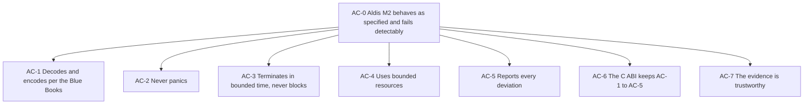

# Assurance case

A structured argument that Aldis, as of Milestone 2, does what its specification says and fails in ways a caller can detect, from four top claims down to the requirements and the evidence that supports them. Requirement: VER-066 ([06 §11](../06-verification.md#11-hazard-analysis-and-assurance-case)). The [hazard analysis](hazards.md) (VER-065) is its other half: each hazard names the claims its controls support, and each claim is weakened by the residuals the hazards state. `cargo xtask assurance` checks that every reference below resolves ([assurance-evidence.md](assurance-evidence.md)).

The case claims no compliance with any standard ([06](../06-verification.md), assurance target). It is written so that a later qualification can take it as its starting point.

## How to read it

- A **claim** is a section `AC-n…`, with a `**Claim.**` paragraph. Its parent is the claim whose ID is its own without the last number; the top claims' parent is `AC-0`.
- A claim with sub-claims has a `**Strategy.**` paragraph: how the sub-claims together establish it.
- A claim without sub-claims is a **leaf** and has an evidence table, `| Evidence | Shows | Requirements |`, whose first column holds references of [assurance-evidence.md](assurance-evidence.md) §2. A row whose Evidence is `TODO` is not yet filled.
- **Context** (`CTX-n`), **assumptions** (`ASM-n`), and **defeaters** (`DF-n`) are listed at the end and referenced with `asm:` and `df:`.
- Evidence that runs only at night says so by its kind (`nightly-test:`, `nightly-check:`, `job:`, `fuzz:`, `proof:`). Every other test, vector, and check runs in the merge gate of every pull request (VER-058), so citing it means it passed on every merged commit.

## AC-0 Aldis M2 behaves as specified and fails detectably

**Claim.** Within the context `asm:CTX-1` and `asm:CTX-2` and under the assumptions `asm:ASM-1` to `asm:ASM-7`, the library crates of Milestone 2 (`aldis-core`, `aldis-time`, `aldis-spp`, `aldis-epp`, `aldis-tm`, `aldis-tc`, `aldis-aos`, `aldis-uslp`) and their C ABI (`aldis-ffi`) decode and encode as the cited Blue Books specify, never panic or block, use bounded resources, and report every deviation they can detect.

**Strategy.** Argue over the four properties of the plan's assurance-case row ([M2 plan](../milestones/m2-frame-codecs.md) §3, WP-8): conformance (AC-1), panic freedom (AC-2), termination (AC-3), bounded resources (AC-4), and deviation reporting (AC-5); then that they hold through the C ABI (AC-6); then that the evidence for all of them can be trusted (AC-7). The hazards of [hazards.md](hazards.md) are the failure modes each claim rules out or bounds; a hazard's residual is a limit on the claim it names.

## AC-1 Aldis decodes and encodes per the cited Blue Books

**Claim.** For every requirement of the frame standards and of the codec contract in the M2 exit criteria ([M2 plan](../milestones/m2-frame-codecs.md) §4), the decoders accept exactly the data units the requirement allows and report them field by field, and the encoders produce exactly the octets the Blue Book specifies (API-020).

**Strategy.** By standard. Each requirement table cites its clauses; each requirement is traced to the tests and vectors of its Verif. column (VER-020); the vectors come from Blue Book material where it exists, and otherwise are hand-derived with a derivation, checked by an independent model written blind (TV-023), and reviewed a second time ([m2-vectors.md](reviews/m2-vectors.md)); every vector passes through the Rust API and the C ABI. The M1 codecs are carried by the M1 exit. The independent cross-check of the frames is still missing (`df:DF-9`).

### AC-1.1 TM frames conform to 132.0-B-3

**Claim.** TM-001…011 hold.

| Evidence | Shows | Requirements |
|---|---|---|
| TODO | Per requirement: the vector cases of `tm/`, the tests of `crates/aldis-tm`, and the C ABI runs, as in AC-1.7 | TM-001…011 |

### AC-1.2 TC frames and the CLCW conform to 232.0-B-4

**Claim.** TC-001…008, TC-020…023, TC-030, and TC-031 hold.

| Evidence | Shows | Requirements |
|---|---|---|
| TODO | Per requirement: the vector cases of `tc/`, the tests of `crates/aldis-tc`, and the C ABI runs | TC-001…008, TC-020…023, TC-030, TC-031 |

### AC-1.3 AOS frames conform to 732.0-B-5 and, in `Issue4Compatible`, to 732.0-B-4

**Claim.** AOS-001…003, AOS-010…019, and GEN-062 hold.

| Evidence | Shows | Requirements |
|---|---|---|
| TODO | Per requirement: the vector cases of `aos/`, the FHEC model, the tests of `crates/aldis-aos`, and the C ABI runs | AOS-001…003, AOS-010…019, GEN-062 |

### AC-1.4 USLP frames conform to 732.1-B-3

**Claim.** USLP-001…010 and USLP-012…016 hold.

| Evidence | Shows | Requirements |
|---|---|---|
| TODO | Per requirement: the vector cases of `uslp/`, the tests of `crates/aldis-uslp`, the SANA snapshot check, and the C ABI runs | USLP-001…010, USLP-012…016 |

### AC-1.5 The common link features conform

**Claim.** The OCF, the CLCW's opacity in `aldis-core`, the FECF, and the OID generator hold their requirements.

| Evidence | Shows | Requirements |
|---|---|---|
| TODO | Per requirement: `core/ocf.json`, `core/crc16.json`, `core/oid.json`, the `aldis-core` tests and fuzz targets | CMN-001…004, CMN-010, CMN-011, CMN-020…023 |

### AC-1.6 The codec contract holds for the frame codecs

**Claim.** The views, writers, configurations, and SDLS layouts of the four frame codecs meet the API model.

| Evidence | Shows | Requirements |
|---|---|---|
| TODO | Per requirement: tests and vectors of the four frame crates | API-010…014, API-020…023, API-040, API-041, API-070, API-072, API-075, GEN-013, GEN-014, GEN-052, GEN-053, GEN-060, GEN-061, RS-012 |

### AC-1.7 The M1 codecs still conform

**Claim.** Every requirement in the M1 exit criteria keeps its artefacts.

| Evidence | Shows | Requirements |
|---|---|---|
| `ci:trace --scope m1 --strict`; `check:spec` | Every requirement of the M1 exit table is traced, on every commit; M1's own exit review established that the artefacts verify them | VER-020 |
| `test:crates/aldis-ffi/tests/vectors.rs::spp_decode_valid`; `test:crates/aldis-ffi/tests/vectors.rs::time_cuc`; `test:crates/aldis-ffi/tests/vectors.rs::epp_invalid` | The M1 vector files pass through the C ABI too (M2 plan D4), for example these three | VER-021, CABI-010, CABI-020 |

## AC-2 Aldis never panics

**Claim.** No public function of the library crates or of the C ABI panics, aborts, or traps for any input value, buffer content, or call sequence (GEN-020).

**Strategy.** Three independent kinds of evidence: a proof by linking that no panic path survives in the exercised release code (AC-2.1); source rules that exclude the constructs that panic, with every exception reviewed (AC-2.2); and dynamic testing that drives arbitrary inputs through every decoder (AC-2.3). AC-2.1 is the strongest; its limits are `df:DF-6` and `df:DF-10`. Hazard: `hz:HZ-X-02`.

### AC-2.1 No panic path survives in the exercised release link

**Claim.** A release build that calls every public function, including every C ABI function, links with a panic handler that references an undefined symbol, on every gating bare-metal target.

| Evidence | Shows | Requirements |
|---|---|---|
| `record:VER-010` | What the exerciser calls (every public API of the library crates and every `aldis_*` function), with which inputs (every live vector case), and how the canary keeps the check from passing vacuously | VER-010, GEN-020, GEN-021 |
| `check:exerciser-thumbv7em-none-eabihf`; `check:exerciser-armv7r-none-eabihf`; `check:exerciser-riscv32imac-unknown-none-elf` | The link check, the canary, and the vector run under QEMU, gating on every pull request | VER-010, GEN-021 |
| `file:exerciser/src/ffi.rs` | The C ABI group of the exerciser (M2 plan D16), so the link check covers `aldis-ffi` | VER-010 |
| `nightly-check:rust-sparc-leon3` | The same on LEON3, reported and not gating (OI-08) | VER-010 |

### AC-2.2 The source excludes the constructs that panic

**Claim.** Library code has no `unwrap`, `expect`, `panic!`, unchecked indexing, or unchecked arithmetic, and no `unsafe` outside `aldis-ffi`; every exception is a reasoned, local `#[expect]`.

| Evidence | Shows | Requirements |
|---|---|---|
| `record:VER-001`; `check:clippy` | The lint set that denies those constructs, and that every crate passes it with no warning | VER-001, GEN-020 |
| `record:RS-016` | Exceptions are local `#[expect(…, reason)]` items, read by the reviewer of each pull request | RS-016 |
| `record:GEN-070`; `record:VER-002` | `unsafe` is forbidden outside `aldis-ffi`, so safe Rust's own guarantees hold there | GEN-070, VER-002 |

### AC-2.3 Arbitrary inputs do not make a decoder panic

**Claim.** Fuzzing and property tests, over arbitrary octets and generated configurations, find no panic.

| Evidence | Shows | Requirements |
|---|---|---|
| `record:VER-022`; `fuzz:tm_decode`; `fuzz:tc_decode`; `fuzz:tc_delimit`; `fuzz:aos_decode`; `fuzz:aos_fhec_model`; `fuzz:uslp_decode`; `fuzz:uslp_truncated`; `fuzz:ffi_decode`; `job:fuzz` | Each target asserts no panic, among its other properties, every night for 600 s; before a release for at least one CPU-hour (`df:DF-3`) | VER-022, GEN-020 |
| `test:crates/aldis-tc/tests/properties.rs::decoder_never_panics`; `test:crates/aldis-tc/tests/properties.rs::delimiter_covers_any_octets`; `test:crates/aldis-uslp/tests/properties.rs::delimiter_covers_any_octets` | Property tests, run on every pull request, over arbitrary decoder and delimiter input | GEN-020, VER-023 |

## AC-3 Every call terminates in bounded time and never blocks

**Claim.** Every call returns, in time bounded by its input length and the configured capacities, without waiting (GEN-022, GEN-023).

**Strategy.** Termination follows from two facts: every loop has a bound (AC-3.1) and nothing recurses (AC-3.2); the bound in time from the same facts, since each bound is an input length, a capacity, or a constant. Not blocking follows from the absence of anything to wait on (AC-3.3). Hazard: `hz:HZ-X-03`.

### AC-3.1 Every loop is bounded

**Claim.** Every loop of library code is bounded by an input length, a compile-time capacity, or a constant.

| Evidence | Shows | Requirements |
|---|---|---|
| `record:GEN-022` | The inspections, one per crate, with each loop's bound, and how they are kept current (VER-061); their approval is pending for the M2 crates (`df:DF-4`) | GEN-022, GEN-023, VER-061 |
| `file:docs/verification/inspections/gen-022-023-aldis-tm.md`; `file:docs/verification/inspections/gen-022-023-aldis-tc.md`; `file:docs/verification/inspections/gen-022-023-aldis-aos.md`; `file:docs/verification/inspections/gen-022-023-aldis-uslp.md`; `file:docs/verification/inspections/gen-022-023-aldis-ffi.md` | The loop tables and call graphs of the M2 crates | GEN-022, GEN-023 |
| `ci:loops`; `check:spec` | Every loop the scanner finds in library code is in its crate's table with a bound, and every loop a table names exists, on every commit | GEN-022 |
| `proof:crates/aldis-core/src/proofs.rs::error_kind_lookup_is_bounded`; `nightly-check:kani`; `file:docs/verification/formal-proofs.md` | A machine proof of one loop's bound, and of the CRC and bit-field loops up to their input lengths; nightly only (`df:DF-2`) | GEN-022 |

### AC-3.2 Nothing recurses

**Claim.** No function of the library reaches itself through any chain of calls.

| Evidence | Shows | Requirements |
|---|---|---|
| `check:stack`; `record:VER-011` | The call graph of the shipped C ABI library and of the exerciser, built from object code on three targets, is checked complete (no indirect call outside stated exemptions) and fails on a cycle | GEN-022 |
| `record:GEN-022` | The inspections' call graphs say the same per crate | GEN-022 |

### AC-3.3 Nothing blocks

**Claim.** Library code has no blocking construct, I/O, clock, or global mutable state to wait on.

| Evidence | Shows | Requirements |
|---|---|---|
| `record:GEN-022` | The inspections list every blocking construct: none | GEN-023 |
| `record:CABI-004`; `check:no-std-thumbv7em-none-eabihf`; `check:no-std-armv7r-none-eabihf`; `check:no-std-riscv32imac-unknown-none-elf` | The bare-metal static library needs nothing from the platform beyond `memcpy` and `memset` equivalents, so it calls no operating system service that could block; GEN-031 and GEN-032 have no record of their own (`df:DF-13`) | CABI-004, GEN-005 |
| `record:GEN-001` | No third-party runtime dependency brings any in | GEN-001 |

## AC-4 Aldis uses bounded resources

**Claim.** Aldis allocates no heap, writes only to the buffers it is given, and needs at most a published, budgeted stack per entry point.

**Strategy.** Memory a call can use is the heap (AC-4.1), its buffers (AC-4.3, AC-4.4), and the stack (AC-4.2). Hazards: `hz:HZ-X-01`, `hz:HZ-X-04`.

### AC-4.1 No heap

**Claim.** No library crate allocates dynamically in any configuration; every capacity is a compile-time parameter.

| Evidence | Shows | Requirements |
|---|---|---|
| `record:GEN-010` | Fixed capacities, and builds with no allocator | GEN-010, GEN-012 |
| `check:no-std-thumbv7em-none-eabihf`; `check:no-std-armv7r-none-eabihf`; `check:no-std-riscv32imac-unknown-none-elf`; `record:GEN-005` | The facade with every feature and the C ABI library build for bare metal without `alloc` | GEN-005, GEN-010 |
| `record:CABI-004` | The shipped static library imports no allocator | CABI-004 |
| `record:GEN-006`; `check:features` | `alloc` and `std` add no API and change no result | GEN-006 |

### AC-4.2 The stack of every entry point is bounded and within its budget

**Claim.** On each bare-metal target, every public Rust function and every C ABI function has a computed worst-case stack within the budget of its kind.

| Evidence | Shows | Requirements |
|---|---|---|
| `record:VER-011`; `check:stack` | The worst case per entry point from `-Z emit-stack-sizes` and the complete call graph, against the budgets, gating; the measurements of 2026-10-25 and the functions over the Rust budget until OI-45 is decided (`df:DF-1`) | VER-011 |
| `file:xtask/stack-budgets.toml` | The budgets (4 096 bytes Rust, 10 240 bytes C ABI, every target) and the stated exemptions | VER-011 |
| `job:stack-sizes` | The per-target table published every night, and for the release | VER-011 |
| `oi:OI-45` | The open question of the channel tables' stack | VER-011, GEN-012 |

### AC-4.3 Outputs stay within their buffers and the data unit

**Claim.** No API needs more output space than the data unit it produces, and none writes outside the buffer it is given.

| Evidence | Shows | Requirements |
|---|---|---|
| TODO | Per frame codec: the writer tests for `BufferTooSmall` and the bound of GEN-014 | GEN-014, API-022 |

### AC-4.4 Memory accesses stay in bounds, whatever the values

**Claim.** Every slice access is bounds-checked, so a wrong length or offset, even one corrupted in memory, gives a wrong result or an error and never an access outside a buffer; an enum corrupted in memory is outside this claim (`asm:ASM-1`).

| Evidence | Shows | Requirements |
|---|---|---|
| `record:VER-001`; `check:clippy` | Unchecked indexing is denied | GEN-020 |
| `record:GEN-015`; `file:docs/hardware-assumptions.md` | What an upset does and does not do, and the assumption that covers the rest | GEN-015 |

## AC-5 Aldis reports every deviation it can detect

**Claim.** In strict mode every checkable violation of a SHALL is an error naming its kind and field; in lenient mode the listed deviations are accepted and reported; a rejection changes nothing; and errors on the link are detected within the bounds of the codes the Blue Books define.

**Strategy.** By the four parts of the API model's error contract (AC-5.1 to AC-5.4), then by the link codes (AC-5.5), whose limits are the residuals of `hz:HZ-X-06`, `hz:HZ-X-07`, `hz:HZ-TC-01`, and `hz:HZ-USLP-01`. Hazard: `hz:HZ-X-08`.

### AC-5.1 Strict mode rejects every checkable violation

**Claim.** API-031 holds for each frame codec, with its two listed exceptions.

| Evidence | Shows | Requirements |
|---|---|---|
| TODO | Per frame codec: the strict-mode error vectors, and the anomaly set empty in strict mode | API-030, API-031 |

### AC-5.2 Lenient mode accepts only the listed deviations, and reports each

**Claim.** API-032 and API-033 hold for each frame codec.

| Evidence | Shows | Requirements |
|---|---|---|
| TODO | Per frame codec: the lenient vectors with their anomaly flags, the flag lists of the standard documents, and the strict ⊆ lenient properties of the fuzz targets | API-032, API-033, GEN-043 |

### AC-5.3 Errors say what failed

**Claim.** Every error carries a catalogued kind, and a field code where it names a field.

| Evidence | Shows | Requirements |
|---|---|---|
| TODO | The field codes of the frame vectors (M2 plan D3), `cargo xtask fields`, and the C ABI detail | GEN-040, GEN-041, API-082 |

### AC-5.4 A rejected input changes nothing

**Claim.** Decoding a malformed data unit, or a rejected encode, leaves caller-visible state as it was.

| Evidence | Shows | Requirements |
|---|---|---|
| TODO | The fuzz targets' GEN-042 assertions and the writer tests of API-022 | GEN-042, API-022 |

### AC-5.5 Errors on the link are detected within the codes' bounds

**Claim.** With the FECF configured, every single-bit error, and every double-bit error in a frame of at most 4 095 octets, is rejected by the receiving checks, or for AOS header errors within the FHEC's reach corrected to the frame sent, and never accepted as another frame.

| Evidence | Shows | Requirements |
|---|---|---|
| `file:docs/verification/derivations/crc16-bit-flips.md` | The 4 095-octet bound of the CRC-16's double-bit guarantee | VER-064 |
| `test:crates/aldis-tm/tests/bit_flips.rs::every_single_bit_error_is_rejected`; `test:crates/aldis-tc/tests/bit_flips.rs::every_single_bit_error_is_rejected`; `test:crates/aldis-aos/tests/bit_flips.rs::every_single_bit_error_of_the_short_frames_is_corrected_or_rejected`; `test:crates/aldis-uslp/tests/bit_flips.rs::every_single_bit_error_of_the_short_frames_is_as_expected` | Every single-bit error, gated | VER-064, TM-005, TC-006, AOS-014, USLP-014 |
| `test:crates/aldis-tc/tests/bit_flips.rs::every_double_bit_error_of_the_short_frames_is_rejected`; `nightly-test:crates/aldis-tc/tests/bit_flips.rs::every_double_bit_error_of_the_longest_frame_is_rejected`; `nightly-test:crates/aldis-aos/tests/bit_flips.rs::every_double_bit_error_within_the_guarantee_is_corrected_or_rejected`; `nightly-test:crates/aldis-uslp/tests/bit_flips.rs::every_double_bit_error_within_the_guarantee_is_as_expected`; `job:bit-flips` | Every double-bit error: of the short frames gated, of the longest frames at night | VER-064 |
| `test:crates/aldis-tc/tests/bit_flips.rs::decode_may_accept_a_frame_length_error_as_a_shorter_frame` | The limit of the guarantee for an error in the Frame Length field (`hz:HZ-TC-01`) | TC-021, VER-064 |
| `test:crates/aldis-uslp/tests/bit_flips.rs::a_double_bit_error_32767_bits_apart_passes_the_fecf` | The limit of the guarantee above 4 095 octets (`hz:HZ-X-06`) | VER-064 |

## AC-6 The C ABI keeps AC-1 to AC-5

**Claim.** A C caller gets the same results as a Rust caller, and a misuse of the C ABI within CABI-022's reach is an error, not undefined behaviour.

**Strategy.** Agreement with the Rust crates on every vector and on fuzzed input (AC-6.1); the argument checks of every function (AC-6.2); the library's freestanding build (AC-6.3). The `unsafe` code of `aldis-ffi` is outside AC-2.2's lint argument, so AC-6.2 and the review of every `// SAFETY:` comment carry it. Hazard: `hz:HZ-X-05`.

### AC-6.1 The C ABI agrees with the Rust API

**Claim.** Every live vector case passes through the C ABI, and on arbitrary input the C ABI decoders agree with the Rust decoders field by field.

| Evidence | Shows | Requirements |
|---|---|---|
| `test:crates/aldis-ffi/tests/vectors.rs::tm_invalid`; `test:crates/aldis-ffi/tests/vectors.rs::tc_validation_failures`; `test:crates/aldis-ffi/tests/vectors.rs::aos_invalid`; `test:crates/aldis-ffi/tests/vectors.rs::uslp_validation_failures` | The vector files through the `extern "C"` functions with the same exact comparison (M2 plan D4), for example these four; `cargo xtask consistency` requires every file of the areas with a C ABI | VER-021, CABI-010, CABI-020, CABI-021 |
| `fuzz:ffi_decode`; `record:VER-022` | The C ABI decoders, validators, and delimiters agree with the Rust ones on fuzzed octets | VER-022, CABI-010 |
| `record:CABI-001`; `check:header` | The generated header matches the library and compiles as C99 and C++11 | CABI-001, CABI-002, CABI-003 |
| `record:CABI-010` | Only C-representable types cross the ABI | CABI-010, CABI-011 |

### AC-6.2 Misuse within CABI-022's reach is an error

**Claim.** Null pointers, inconsistent lengths, wrong struct sizes, and bad helper storage are reported as errors.

| Evidence | Shows | Requirements |
|---|---|---|
| `test:crates/aldis-ffi/tests/tc.rs::writer_arguments_are_checked`; `test:crates/aldis-ffi/tests/tm.rs::writer_arguments_are_checked`; `test:crates/aldis-ffi/tests/uslp.rs::content_and_fields_are_checked_as_arguments`; `test:crates/aldis-ffi/tests/tm.rs::vc_arrays_step_by_their_struct_size`; `test:crates/aldis-ffi/tests/uslp.rs::vc_and_map_arrays_step_by_their_struct_size` | Pointer, length, and struct-size checks of the frame functions | CABI-022, CABI-033 |
| `record:CABI-030` | The capacities of the helper storage, generated and checked | CABI-030 |

### AC-6.3 The C ABI library is freestanding

**Claim.** The static library builds for bare metal without `std`, a heap, threads, or a C runtime.

| Evidence | Shows | Requirements |
|---|---|---|
| `record:CABI-004`; `check:no-std-thumbv7em-none-eabihf` | The bare-metal archive and its imports | CABI-004 |

## AC-7 The evidence is trustworthy

**Claim.** The evidence above is what it says: produced from the commit it describes, by checks that cannot be skipped unnoticed, reviewed independently, and kept current.

**Strategy.** By the parts of the process that produce and judge the evidence: the merge gate and its records (AC-7.1), the independent review (AC-7.2), vectors and models independent of the implementation (AC-7.3), the recorded decisions (AC-7.4), the measures of test adequacy (AC-7.5), and the independent nightly run (AC-7.6).

### AC-7.1 Every merged commit carries a passing record of every gating check

**Claim.** No pull request merges without a published record, for its own tree, in which every gating check passed or was soundly skipped or reused.

| Evidence | Shows | Requirements |
|---|---|---|
| `record:VER-056`; `record:VER-057`; `record:VER-058` | The run, its pinned image, the input rule for skips and reuses and its re-derivation, the record, and the branch protection that requires it; skips rest on complete input lists (`df:DF-12`); records are unsigned (`df:DF-5`) | VER-056, VER-057, VER-058 |
| `record:VER-060` | A run on a GitHub-hosted runner meets the same rule | VER-060 |

### AC-7.2 Every change is reviewed independently

**Claim.** Each pull request is reviewed by someone other than its author, against the Blue Book and the requirements, citing the code.

| Evidence | Shows | Requirements |
|---|---|---|
| `file:AGENTS.md`; `file:docs/process/decision-rights.md` | The review rules (what a reviewer reads, the citation rule, every suppression read) and who decides each finding | VER-062 |
| `file:docs/verification/reviews/m2-vectors.md` | The second review of the M2 frame vectors, hand-derived with worked notes, and its findings resolved | TV-020 |

### AC-7.3 Vectors and models are independent of the code they check

**Claim.** Expected values do not come from the implementation.

| Evidence | Shows | Requirements |
|---|---|---|
| `record:TV-023` | Every independent model a vector file names runs and agrees, and models are written blind | TV-023 |
| `record:TV-021` | Released vectors are never edited | TV-021 |
| `file:docs/verification/cross-checks.md` | The independent implementations searched and run; none yet for the frames (`df:DF-9`) | VER-040 |

### AC-7.4 Decisions are taken by the right role and recorded

**Claim.** Every reading the Blue Book does not settle, and every scope and convention decision, was the maintainer's and is in the log.

| Evidence | Shows | Requirements |
|---|---|---|
| `record:VER-062`; `ci:decisions` | The decision rights and the format of the log, checked on every commit | VER-062 |

### AC-7.5 The tests are adequate by measure

**Claim.** Every requirement is traced, every region and branch of Layers 0–2 is covered, and surviving mutants are triaged.

| Evidence | Shows | Requirements |
|---|---|---|
| `record:VER-020`; `ci:trace --scope m2` | The trace of the M2 scope, strict at the exit | VER-020 |
| `record:VER-024`; `check:coverage` | 100 % regions, functions, lines, and branches, with no waiver; MC/DC is not measured (`df:DF-14`) | VER-024 |
| `record:VER-025`; `job:mutants`; `file:docs/verification/mutants-triage.md` | Mutation testing every night and its triage | VER-025 |

### AC-7.6 An independent run repeats every check each night

**Claim.** Every check runs again each night on `main`, on GitHub's machines, and a failure opens an issue.

| Evidence | Shows | Requirements |
|---|---|---|
| `record:VER-059`; `job:verify` | The nightly run of every check through `cargo xtask verify` on both Linux architectures; it is failing at the time of writing (`df:DF-8`) | VER-059 |

## Assumptions and context

| ID | Assumption | Basis | Integrator obligation |
|---|---|---|---|
| CTX-1 | The case covers Milestone 2: the library crates of AC-0 and their C ABI. It does not cover what the M2 plan leaves out (CMN-024; API-074 and the engines' security hooks; USLP-011 and the LNK requirements; COP-1; the C ABI handles of FOP-1, FARM-1, and the link engines; CABI-040, CABI-041, CABI-050, CABI-060, CABI-070…072; VER-026 and VER-050's full matrix; synchronization and channel coding) | [M2 plan](../milestones/m2-frame-codecs.md) §4, "Not in M2" | — |
| CTX-2 | Aldis is a library. The mission's hazard analysis owns mission effects; this case argues the library's contract | [hazards.md](hazards.md) §1.1 | Take [hazards.md](hazards.md) into the mission's own analysis |
| ASM-1 | Memory that holds Aldis state between calls is protected against single-event upsets, or does not change at run time | GEN-015, [hardware assumptions](../hardware-assumptions.md) §1 | EDAC with scrubbing; configurations in `const` context and read-only memory (RS-012); an uncorrectable error as a reset ([hardware assumptions](../hardware-assumptions.md) §3) |
| ASM-2 | A receiver runs the receiving checks the codec provides | TC-020, TC-021, TM-011, USLP-014, USLP-015, API-011 | TC and USLP over TC Synchronization and Channel Coding: delimit each clean data unit with `FrameDelimiter` and pass every frame to `validate_frame`, given exactly the frame's octets where its boundary is known independently of the Frame Length field (`hz:HZ-TC-01`). TM: call `validate`, or decode with `decode_with` (`hz:HZ-TM-01`) |
| ASM-3 | Each context that calls Aldis has the stack the published table gives for the functions it calls | VER-011 | Add the worst case of `target/spec/stack-<target>.md` to the caller's own frames and to interrupt use |
| ASM-4 | The synchronization and channel coding sublayer below passes only data units it found free of errors, and the FECF is configured wherever a frame error that the code misses would be unacceptable | 232.0 §4.4.9.2.3; 732.1 §4.3.11.2.1; the FECF a managed parameter of every frame standard | Configure the FECF (and, for AOS, the FHEC) unless the mission's analysis accepts the residuals of `hz:HZ-TC-02`, `hz:HZ-TM-01`, `hz:HZ-AOS-01`, and `hz:HZ-USLP-03` |
| ASM-5 | Flight reception decodes in strict mode, the default, unless the mission accepts the lenient deviations; a lenient caller reads the anomaly set | API-030, API-032, GEN-043 | Decide the mode per channel; act on anomalies (`hz:HZ-X-08`) |
| ASM-6 | A C caller passes valid pointers and the true sizes of its buffers | CABI-022 | Test the integration under the platform's own tools; Aldis checks null pointers and length consistency only (`hz:HZ-X-05`) |
| ASM-7 | A USLP sender does not send non-truncated frames on a VC that has a Truncated Transfer Frame Length | 732.1 Annex D1.2 (notes; `proposal:P-USLP-04`) | Configure truncated and non-truncated frames on different VCs (`hz:HZ-USLP-02`) |

## Defeaters

What weakens the case now. A defeater is `open` until what it names is done; `cargo xtask assurance` fails on an open defeater whose OI is resolved, so that the list stays honest.

| ID | Defeater | Weakens | References | Status |
|---|---|---|---|---|
| DF-1 | The channel tables' stack is undecided: the Rust budget is 4 096 bytes until the maintainer decides, and the largest C ABI function needs about 8.6 KB | `ac:AC-4.2` | `oi:OI-45`; `record:VER-011` | `open` |
| DF-2 | The Kani proofs run only at night and are not gating; the method for proven requirements is open | `ac:AC-3.1` | `oi:OI-42`; `nightly-check:kani` | `open` |
| DF-3 | The one CPU-hour per fuzz target of VER-022 is due before the release; the nightly runs give 600 s per target | `ac:AC-2.3` | `record:VER-022`; `job:fuzz` | `open` |
| DF-4 | The GEN-022/023 inspections of `aldis-tm`, `aldis-tc`, `aldis-uslp`, and `aldis-ffi` are prepared and pending the exit review (VER-061) | `ac:AC-3.1`; `ac:AC-3.3` | `record:VER-061`; `file:docs/verification/inspections/gen-022-023-aldis-tc.md` | `open` |
| DF-5 | The verification records are git notes without a signature; the signed evidence of #107 is parked | `ac:AC-7.1` | `gh:#110` | `open` |
| DF-6 | The shipped `aldis-ffi` static library is built without LTO, so the link check of VER-010, made on the exerciser's LTO build, does not cover it as shipped; its panic handler spins (`proposal:P-X-01`, `proposal:P-X-02`) | `ac:AC-2.1` | `gh:#114`; `hz:HZ-X-02` | `open` |
| DF-7 | No check runs `aldis-ffi` under Miri, which GEN-071 requires; it was run once by hand in WP-0c; the C harness with sanitizers is M5's | `ac:AC-6.2` | `gh:#71` | `open` |
| DF-8 | The nightly run is failing: on 2026-10-25 the check `coverage` stopped on an index panic in the test strategy `crates/aldis-testkit/src/strategies/aos.rs`, inside the property test `arbitrary_octets_never_panic` (a test fixture, not library code), the mutants job was interrupted, and the non-gating `cpp-leon3` failed. Until it is fixed the independent nightly repetition gives no evidence | `ac:AC-7.6`; `ac:AC-7.5` | `gh:#96`; `job:verify` | `open` |
| DF-9 | No independent implementation has cross-checked any frame codec yet (M2 plan D15); frame conformance rests on Blue Book material, hand derivations, blind models, and the second review | `ac:AC-1` | `file:docs/verification/cross-checks.md`; `oi:OI-32` | `open` |
| DF-10 | The link check covers the generic instantiations the exerciser makes; an integrator's other capacities are not linked; LEON3 is not gating (OI-08) | `ac:AC-2.1` | `record:VER-010`; `nightly-check:rust-sparc-leon3` | `open` |
| DF-11 | The stack bound leaves out interrupts and the caller's own frames | `ac:AC-4.2` | `record:VER-011` | `open` |
| DF-12 | Skipping and reusing checks is sound only if every check's input list is complete; a missing path goes unchecked until the nightly run | `ac:AC-7.1` | `record:VER-056` | `open` |
| DF-13 | GEN-031 and GEN-032 (no clocks, no I/O, no global state) have no verification record and are untraced (`proposal:P-X-03`) | `ac:AC-3.3` | `hz:HZ-X-03` | `open` |
| DF-14 | MC/DC is not measured | `ac:AC-7.5` | `oi:OI-09`; `record:VER-024` | `open` |
| DF-15 | The hazard analysis is incomplete: most categories of the four codec files are TODO | `ac:AC-0` | `file:docs/verification/hazards.md` | `open` |
